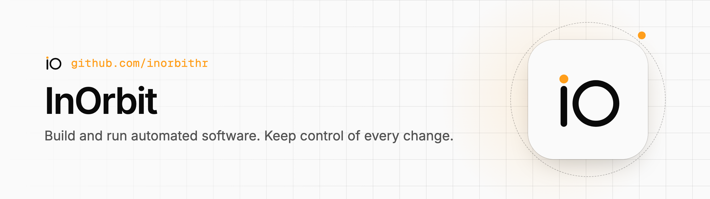

<p align="center"><a href="https://inorbit.hr">
  <picture>
    <source media="(prefers-color-scheme: dark)" srcset="https://raw.githubusercontent.com/inorbithr/.github/main/.github/assets/hero-dark.png">
    
  </picture>
</a></p>

<h3 align="center">Engineering doesn't stop at code.</h3>

<p align="center">
  One workspace for people, AI agents, and the systems they build and operate.<br>
  Give agents context and memory. Coordinate their work. Control execution. Verify outcomes with evidence.
</p>

<p align="center">
  <a href="https://inorbit.hr">inorbit.hr</a> ·
  <a href="https://developers.inorbit.hr/">Developers</a> ·
  <a href="https://inorbit.hr/open-source/">Open source</a> ·
  <a href="https://status.inorbit.hr">Status</a> ·
  <a href="mailto:reach@inorbit.hr">reach@inorbit.hr</a>
</p>

---

### What InOrbit is

- **Change flow:** request or incident → plan → pull request → CI checks → approval by a
  person → merge → rollout. Each step is recorded with its evidence.
- **Interfaces:** HTTP API with server-sent events and a WebSocket stream, the `iohr`
  command line, SDKs (Rust, TypeScript, Python, Go; C# and Java from source), an MCP
  server and extensions.
- **Agent:** `dataplane` runs checks inside your network over one outbound WebSocket to
  `api.inorbit.hr`. It opens no inbound ports.
- **Status:** pre-release, with partners. SOC 2 and ISO 27001 in preparation; no audit
  completed.
- **Company:** InOrbit d.o.o., Croatia.

<p align="center"><a href="https://status.inorbit.hr">
  <picture>
    <source media="(prefers-color-scheme: dark)" srcset="https://api.inorbit.hr/v1/status/widget.svg?theme=dark">
    
  </picture>
</a><br><sub>Live from <a href="https://status.inorbit.hr">status.inorbit.hr</a></sub></p>

### Open source here

The agent, the SDKs and the command line are open source; the platform is not. The
[open source page](https://inorbit.hr/open-source/) lists them.

| Repository | What it is | Release |
| --- | --- | --- |
| [**dataplane**](https://github.com/inorbithr/dataplane) | The agent that runs checks inside your network and connects outbound only. Its Helm chart is published with it. | [](https://github.com/inorbithr/dataplane/releases) |
| [**sdk**](https://github.com/inorbithr/sdk) | `iohr`, the command line, and SDKs for the InOrbit API: Rust, TypeScript, Python and Go on their registries, C# and Java from source | [](https://github.com/inorbithr/sdk/releases) |
| [**homebrew-tap**](https://github.com/inorbithr/homebrew-tap) | `brew install inorbithr/tap/iohr`, the command line for macOS and Linux | follows the `iohr` releases |

### Try it

```sh
brew trust inorbithr/tap
brew install inorbithr/tap/iohr
iohr login
```

Write to [reach@inorbit.hr](mailto:reach@inorbit.hr) for early access, a pilot or a
partnership. Security reports go to the contact in
[security.txt](https://inorbit.hr/.well-known/security.txt).
